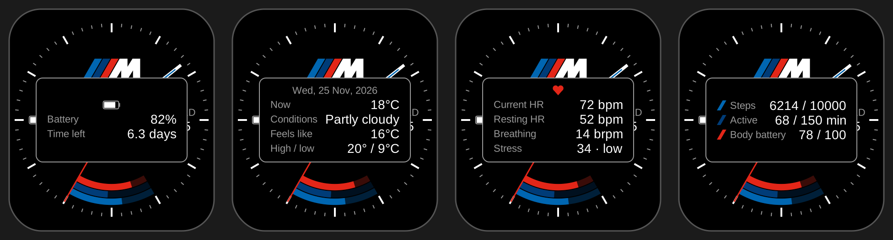

# bmw-m-watchface

An analog BMW M Motorsport watch face for Garmin Connect IQ. Target device:
**Venu X1** (`venux1`).

## Wireframe


Touch targets on the dial, numbered, with the card each one shows:


Quick cards (battery, weather and the three activity figures):



These are mock-ups with example values and the time set to 10:08:35. They are not
simulator screenshots. They are generated from `source/Theme.mc` by
`tools/wireframes.py`, so they follow the theme. See [Wireframe tool](#wireframe-tool).

## Features

- Analog chronograph dial with a white-sword hand set, a red second hand and a roundel at the hand
  pivot. In the watch's low-power (always-on) draw, the colours are dimmed to 60% and the second hand is dropped.
- M badge at 12 o'clock, centred between the roundel and the 12 o'clock tick, drawn from the flat M logo's geometry.
- Three activity rings inside the lower dial, in the badge colours:
  steps (blue), weekly active minutes (navy) and body battery (red).
- Two readouts on one arc, the same distance from the centre as the middle ring: the date at
  3 o'clock, and the watch battery at 9 o'clock as a simple icon that empties as the battery
  drains (red below 20%). The temperature is not on the dial.
- Quick cards. Hold the date, battery, roundel or rings and a card appears over the dial. Every
  card has the same size and layout: rows of grey label on the left and white value on the right,
  every value with its unit.
  - Date: the weather: `Now`, `Conditions`, `Feels like`, `High / low`.
  - Battery: `Battery` (%) and `Time left` (days), plus `Status: Charging` when charging.
  - Roundel: `Current HR` and `Resting HR` (bpm), `Breathing` (brpm) and `Stress` (a 0 to 100 score
    with its band: resting, low, medium, high).
  - Rings: `Steps`, `Active` (minutes this week) and `Body battery` (/ 100), each row marked with a
    slanted M stripe in its ring's colour.

  Touch anywhere to dismiss a card; it also goes after four seconds. The temperature is not on the
  dial: the date is the way to the weather.

**Why a hold, and why no pages.** Garmin's `WatchFaceDelegate` documents only `onPress` (touch and
hold). A plain tap and a swipe are never delivered to a watch face, and the simulator sends only
holds. An earlier version had full-screen detail pages and graphs (Activity, steps, active minutes,
body battery, heart rate, weather, with sleep bands), reached by holding a zone then holding its
card, and navigated by holds at the screen edges. That was clunky, and the watch's own software
already provides those screens, so the pages were removed. They are still in git history: the last
commit that has them is `0dbd5eb` (`git show 0dbd5eb:source/BmwMDetail.mc`).

## Running on Windows or macOS (no container)

The project is plain Monkey C, so it builds with the Garmin tooling directly. The bash scripts
(`build.sh`, `tools/test.sh`, `tools/sim.sh`) are for the Linux devcontainer; you do not need them.

1. Install the Connect IQ SDK with Garmin's SDK Manager, and in it download the **Venu X1** device.
2. Install VS Code and the **Monkey C** extension (`garmin.monkey-c`). Open this folder normally,
   not "Reopen in Container".
3. Run **Monkey C: Verify Installation**, then **Monkey C: Generate a Developer Key** (once).
4. **Run face in simulator** (F5, or Run > Start Debugging) builds, starts the simulator and loads
   the face. **Run unit tests** does the same with the tests. Both are in `.vscode/launch.json`.
   `System.println` output (the `FONTS` and `TOUCH` lines) is in the Debug Console.
5. To put it on the watch: **Monkey C: Build for Device**, then copy the `.prg` into the watch's
   `GARMIN/APPS` folder (the watch appears as an MTP device in Explorer).
6. `uv run tools/wireframes.py` works on any platform with [uv](https://docs.astral.sh/uv/).

The Linux simulator crashes in the devcontainer (see Build below); Garmin's bug tracker also has
crash reports for the 9.2.0 simulator on Windows, so if it misbehaves try 9.1.0 or 9.3.0.

## Layout

```
manifest.xml          app id, target product, permissions
monkey.jungle         build configuration
source/
  BmwMWatchApp.mc       app entry
  BmwMWatchView.mc      dial, rings, hands, roundel, the card's show / expire logic
  BmwMWatchDelegate.mc  forwards touches to the view
  Cards.mc              the quick card: build() reads the watch, draw() only paints
  CardContent.mc        what a card shows (labels, values, ring colours)
  Snapshot.mc           what the dial shows from the watch (ring fractions, battery), refreshed before drawing
  Fonts.mc              the three font roles as vector fonts (falls back to system fonts)
  Theme.mc              colours, spacing, font sizes and touch targets used everywhere
  Geometry.mc           ring sizes and touch hit-testing (pure, tested)
  Logo.mc               the M badge's stripe geometry (pure, tested)
  Stats.mc              battery threshold and number formatting (pure, tested)
  BatteryIcon.mc        the battery icon at 9 o'clock
  Units.mc              the temperature unit setting (pure, tested)
  Vitals.mc             body battery: newest sample with data, last reading kept in storage
  tests/                unit tests, run with ./tools/test.sh
resources/            strings, settings and launcher icon
build.sh              compile to bin/bmw-m-watchface.prg (devcontainer)
tools/wireframes.py   regenerates the README wireframes from Theme.mc
tools/launcher_icon.py  regenerates the launcher icon
tools/test.sh         builds with unit tests and runs them in the simulator (devcontainer)
tools/sim.sh          starts the simulator and loads the face (devcontainer)
docs/                 README images
.devcontainer/        devcontainer (Ubuntu 22.04, SDK from a shared feature, uv, Go)
.vscode/              tasks and launch configurations
```

## Settings

One setting, **Units**, in the Garmin Connect app (the watch face's settings):

- **Follow watch** (default): the temperature uses the watch's own temperature unit.
- **Metric (°C)** or **Imperial (°F)**: override it.

The conversion and rounding live in `source/Units.mc` and are covered by tests (`UnitsTests.mc`).
The setting is defined in `resources/properties/` and `resources/settings/`.

## Wireframe tool

`tools/wireframes.py` draws the dial, the touch targets and the cards from the same colours,
spacing, font sizes and logo geometry the watch face uses. It reads `source/Theme.mc`, so after
changing the theme you can rerun it and see the result without a simulator. It is a
[uv](https://docs.astral.sh/uv/) script: its one dependency is declared at the top of the file and
uv installs it on the fly, so there is no `pip install` and no virtualenv to manage.

```sh
uv run tools/wireframes.py              # render PNGs into docs/
uv run tools/wireframes.py --svg-only   # write SVGs instead
uv run tools/wireframes.py --out /tmp/wf
```

PNG output needs one SVG renderer: `rsvg-convert` (`sudo apt install librsvg2-bin`),
Inkscape, the `cairosvg` package (which uv installs for you), or Google Chrome /
Chromium (set `CHROME_PATH` if it isn't on your `PATH`). The tool tries them in that
order. There is also a **Regenerate wireframes** task in VS Code.

Only colours, font sizes and the spacing tokens are read from `Theme.mc`. The layout in
`BmwMWatchView.mc` and `Cards.mc` (positions as fractions of the dial radius, the logo geometry,
hand lengths) is mirrored inside the script, so if you change that layout, update the matching
function in `tools/wireframes.py` too. Different renderers use different fonts, so text widths
vary slightly.

## Tests

The logic that does not need the watch is split into small modules (`Geometry`, `Logo`, `Stats`,
`Units`, `Theme`) and covered by Connect IQ unit tests in `source/tests/`: 25 tests for the touch
hit-testing, the badge geometry, number formatting, the unit conversion and the theme mappings.
Drawing code and anything that reads live watch data is not tested.

```sh
./tools/test.sh      # builds with --unit-test and runs monkeydo -t in the simulator
```

or run **Run unit tests** from VS Code. The tests are `(:test)` functions, which a normal build
ignores, so they do not affect the watch face.

## How it is organised: reading is kept apart from drawing

Nothing in the drawing code reads the watch. Each `onUpdate` does two steps in order:

1. `refreshData()` reads what is needed: whether this is the low-power draw
   (`System.getDisplayMode`), the dial's `Snapshot` (steps, active minutes, body battery, battery;
   at most every 10 s, and in the low-power draw only if nothing has ever been read, with no slow
   sensor-history read), and the open card's `CardContent` (`Cards.build`, each update while a card
   is up so the heart rate moves).
2. `drawFace()` paints from the snapshot and the card content, and from the clock for the hands.

A draw therefore never waits on a sensor, which matters most for the always-on draw: the watch
gives it very little time, and a draw that runs over can be cut off and leave a half-drawn frame.

## Design tokens

Everything visual comes from `source/Theme.mc`, so a change there changes the whole face.

- **Colours:** exactly eight, plus black for the background. The three BMW M logo
  colours (blue `0066B1`, navy `003C78`, red `E32618`), a muted tint of each for empty
  tracks, white, and one grey `999999` for secondary text.
- **Spacing:** one 2 px gap between the badge stripes and between ring bars; the outer ring sits
  6 px inside the major ticks (`RING_TICK_GAP`) so the two never touch. Ring bars are as wide as the
  badge stripes.
- **Fonts:** three roles (label, value, title), drawn as vector fonts at the pixel sizes
  `FONT_PX_*` in `Theme.mc` (`Fonts.mc` loads them, falling back to the system fonts). The
  date's two lines are stacked from the real font heights (`Dc.getFontHeight`), so they cannot
  overlap whatever the device's fonts are.

The touch targets' sizes (the shared radius of the roundel, date and battery circles, the
rings arc) are tokens too, read by both the app and the wireframe tool, so the
touch-targets image follows the code. The dial's own layout (badge, hands, roundel, tick lengths)
is written as fractions of the dial radius in `BmwMWatchView.mc` rather than tokens.

## Build

### In the devcontainer

Open the repo in VS Code ("Reopen in Container") or a Codespace. The container (Ubuntu 22.04)
installs the Connect IQ SDK (version in `.devcontainer/devcontainer.json`) and generates a local
signing key (`developer_key.der`, git-ignored). Downloading the Venu X1 device files needs a
Garmin account, so export these on the host before opening the container:

```sh
export GARMIN_USERNAME="you@example.com"
export GARMIN_PASSWORD="..."
```

Accounts with two-factor auth may not work non-interactively. If login fails, run
`connect-iq-sdk-manager login` once inside the container, then
`connect-iq-sdk-manager device download --manifest manifest.xml`.

```sh
./build.sh            # builds bin/bmw-m-watchface.prg for venux1
./build.sh <device>   # another product id listed in manifest.xml
./tools/test.sh       # the unit tests
./tools/sim.sh        # the simulator
```

The container's `runArgs` has `--userns=keep-id` for rootless Podman. Docker rejects that flag, so
remove it (or use `--userns=host`) if you use Docker.

**The Linux simulator is unstable.** In the container, SDK 9.1.0, 9.2.0 and 9.3.0 all segfault in a
worker thread, even running Garmin's own sample watch face; it lasts longer with no network, which
is why `tools/sim.sh` runs it that way and restarts it. The unit tests run fine. To see the face,
use the simulator on Windows or macOS, or sideload to the watch.

### Without the devcontainer

See [Running on Windows or macOS](#running-on-windows-or-macos-no-container).

## Status

Compiled and run on a Venu X1 and in the Windows simulator; the unit tests pass.

- A watch face may not use `Toybox.Timer` (the first run on a watch failed with "Symbol 'start' not
  available to 'Watch Face'"), so the card expires by timestamp, checked in `onUpdate`. If a card
  lingers, that is where to look.
- Touch input uses `WatchFaceDelegate`. Garmin documents only `onPress` (touch and hold) for watch
  faces; a plain tap is not delivered. Confirmed in the simulator: a hold arrives, a tap does not.
  `onTap` is wired to the same handler in case a device sends it. The face logs `TOUCH onPress
  x,y` / `TOUCH onTap x,y` to the console.
- Errors: drawing and touch handling are wrapped in `try/catch`. If something throws, the face shows
  `ERROR` and the message for 10 seconds (and prints it to the console) instead of crashing back to
  the default face. The watch's own crash log is `GARMIN/APPS/LOGS/CIQ_LOG.YML` (`.BAK` is the older
  one); it only records errors the watch reports, so a hard freeze may leave nothing.
- Low power: whether the face is being drawn in the watch's low-power (always-on) mode is asked of
  the watch at each draw (`System.getDisplayMode`), not remembered from `onEnterSleep` /
  `onExitSleep`. In that draw the colours are dimmed to 60% (`Theme.LOW_POWER_PCT`; never grey, so
  the ring fills still read against their empty tracks), the second hand is dropped, and a touch is
  left to the watch so it can wake the screen. With Always-On Display off the watch turns the screen
  off and never asks for that draw, so the dimmed look only appears when always-on is active. An
  earlier version kept a sleep flag set by `onEnterSleep` and cleared by `onExitSleep`; the exit call
  was missed once and the face stuck dim on an awake screen. Always-on draws are limited by Garmin
  to about 10% of the pixels lit each minute, so watch for the watch blanking or dimming the face
  if it exceeds that.
  The low-power draw also does no slow work: it skips the body battery history read and uses the last
  known value (`Vitals.bodyBattery(false)`), because the watch gives that draw very little time, and
  a draw that runs over can be cut off and leave the screen stuck on a half-drawn frame.
- Check on the watch that the Units setting appears in Garmin Connect and that changing it
  redraws the face (`onSettingsChanged`).
- Layout clearances (date and battery against the ticks, the ring band against the ticks) were
  tuned from simulator screenshots; recheck on the watch.

## Trademarks

BMW, the BMW roundel and the BMW M logo are trademarks of BMW AG. The badge and
roundel here are stylised redraws for personal use and are not endorsed by BMW.
Do not publish this face to the Connect IQ store with them.
