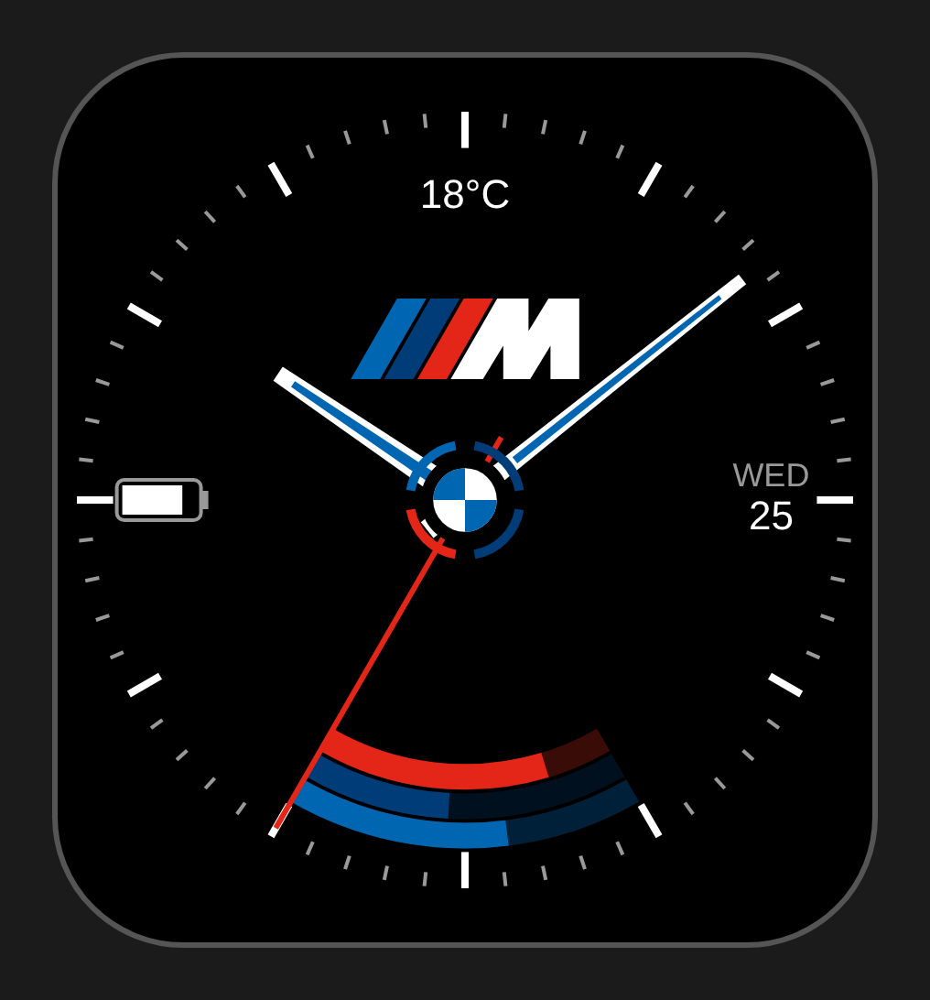
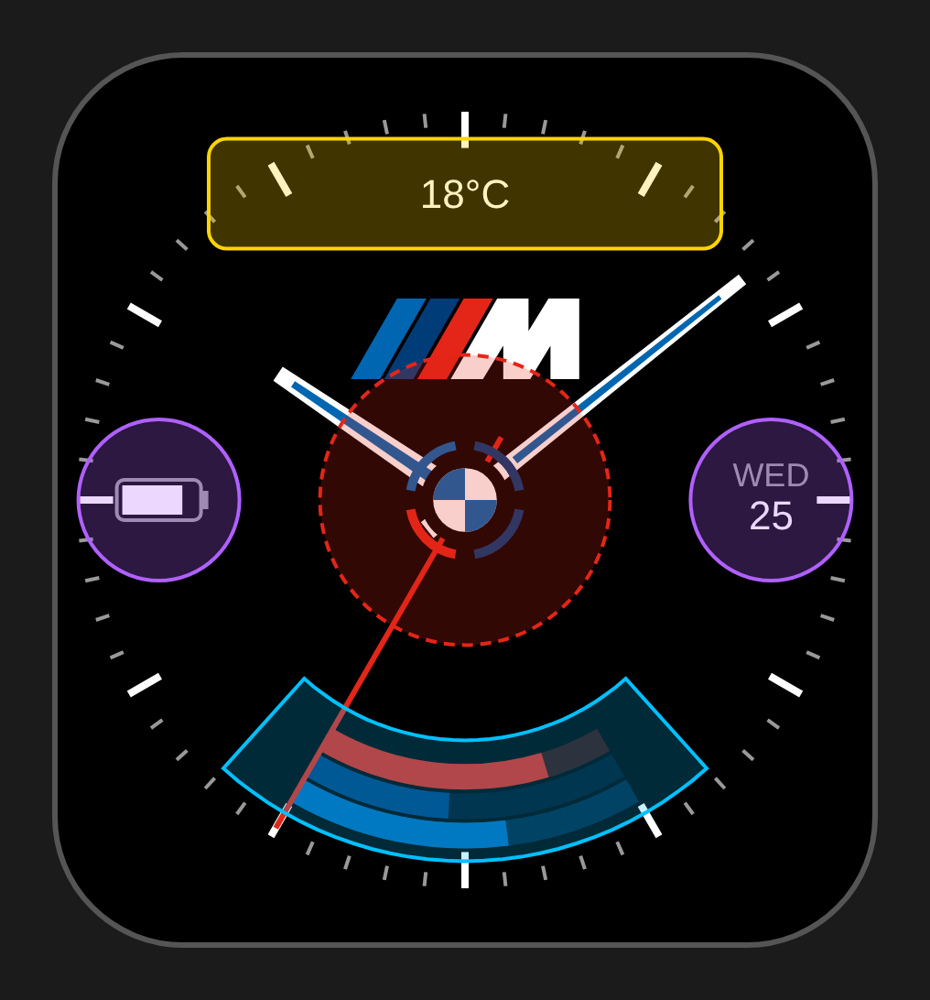
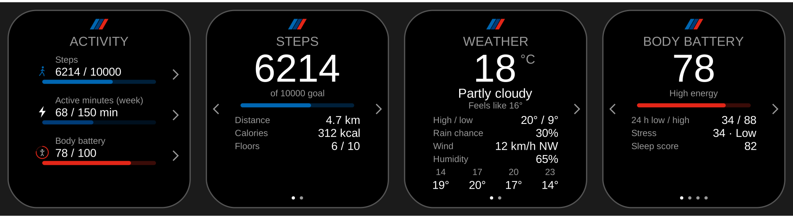
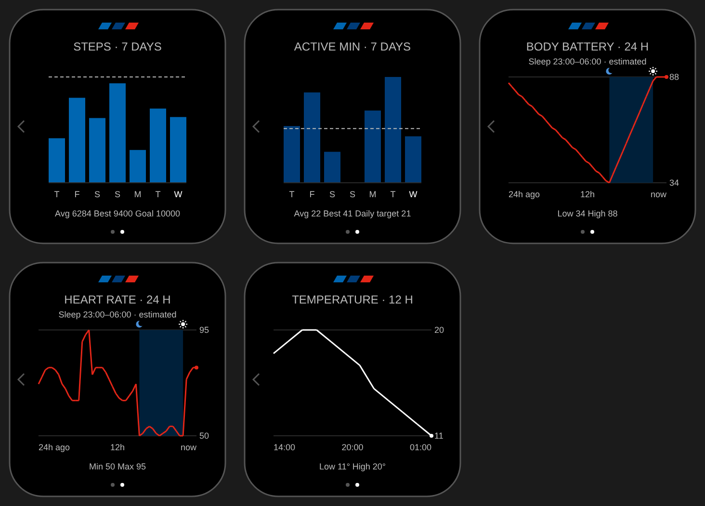

# bmw-m-watchface

An analog BMW M Motorsport watch face for Garmin Connect IQ. Target device:
**Venu X1** (`venux1`).

## Wireframe



Tap and hold zones: yellow is the temperature (opens weather), purple is the date and
battery (a card, no page), red is the roundel (opens heart rate) and blue is the ring band
(opens Activity). A hold on any of them shows its quick card.



Tap pages (Activity, a metric page, weather):



Quick cards, shown on touch and hold (battery, weather and the three activity figures):


Graph pages (the second page behind each detail page):



These are mock-ups with example values and the time set to 10:08:35. They are not
simulator screenshots. They are generated from `source/Theme.mc` by
`tools/wireframes.py`, so they follow the theme. See [Wireframe tool](#wireframe-tool).

## Features

- Analog chronograph dial with a white-sword hand set, a red second hand
  (hidden in low-power mode) and a roundel at the hand pivot.
- M badge at 12 o'clock, drawn from the flat M logo's geometry.
- Three activity rings inside the lower dial, in the badge colours:
  steps (blue), weekly active minutes (navy) and body battery (red).
- Three readouts on one arc, the same distance from the centre as the middle ring: the
  temperature at 12 o'clock, the date at 3 o'clock, and the watch battery at 9 o'clock as a
  simple icon that empties as the battery drains (red below 20%).
- Quick cards on touch and hold: hold the temperature, date, battery, roundel or rings and a
  small card appears over the dial with more detail (weather and feels-like, the date in full,
  battery percentage and days left, heart rate with resting rate and stress, the three activity
  figures). It disappears after four seconds or on the next tap. It is not a page.
- Tap pages. Tap a zone on the dial to open a full-screen page:
  - ring band: the **Activity** page, with steps, active minutes and body battery
    as rows. Tap a row to open that metric's page.
  - roundel: heart rate (resting, today's low and high)
  - the temperature above the badge: weather (conditions, feels-like, high/low, rain chance, wind,
    humidity, next four hours)
- Recovery on the Body Battery pages: its detail page also shows stress (current score
  and band: resting, low, medium, high) and sleep score. Behind it are four pages in
  all: detail, body battery over 24 hours, stress over 24 hours, and the watch's
  temperature sensor over 24 hours (labelled "sensor temp", because the docs don't say
  whether it is skin temperature on the Venu X1; check on the watch). HRV is not
  available to a watch face. The SDK has no HRV history or status.
- Graph pages. Every metric page has a graph page behind it: steps and active
  minutes for the last 7 days (each day is a small gauge: dark track up to the goal,
  bright fill to the value, in the same colours as the dial rings), body battery over 24 hours,
  heart rate over 24 hours, and a 12 hour temperature forecast for weather, with precipitation bars behind the line (blue for rain, white for snow and other frozen
  precipitation)
  and a cloud-cover strip above it (both are forecast values, like the temperature).
- Sleep on the body battery and heart rate graphs: a faint band with a moon at
  bedtime and a sun at wake time, and a caption saying where it came from. **This is
  not measured sleep.** Connect IQ does not expose sleep data to a watch face; the only
  sleep fields in the SDK are the typical sleep and wake time you set in Garmin
  Connect. So the band is inferred first: the longest stretch of at least 4 hours where
  heart rate is lowest while body battery rises (caption "estimated"). If the data
  isn't clear, it falls back to your configured sleep and wake times (caption
  "schedule"). With neither, no band is shown.
- Navigation uses taps only, because a watch face does not receive swipes. Tap the
  right side of a page to go forward (detail, then graph) and the left side to go
  back. Chevrons at the edges and page dots at the bottom show what is possible.
  Tap the top strip to close. A page also closes after 20 seconds of no taps, or when
  the watch dims.

## Layout

```
manifest.xml          app id, target product, permissions
monkey.jungle         build configuration
source/
  BmwMWatchApp.mc       app entry
  BmwMWatchView.mc      dial, rings, hands, roundel, tap hit-testing
  BmwMDetail.mc         Activity, detail and graph pages, and their navigation cues
  Theme.mc              colours, spacing and font roles used everywhere
  Geometry.mc           ring sizes and tap hit-testing (pure, tested)
  PageNav.mc            which page is open and how taps move between pages (pure, tested)
  SleepInference.mc     estimated sleep window from heart rate and body battery (pure, tested)
  Stats.mc              min/max/average, time buckets, clock text (pure, tested)
  Precip.mc             rain vs snow from the forecast condition (tested)
  tests/                unit tests, run with ./tools/test.sh
  BmwMWatchDelegate.mc  forwards taps to the view
resources/            strings and launcher icon
build.sh              compile to bin/bmw-m-watchface.prg
tools/wireframes.py   regenerates the README wireframes from Theme.mc
tools/test.sh         builds with unit tests and runs them in the simulator
docs/                 README images
.devcontainer/        devcontainer + post-create (SDK from a shared feature)
.vscode/tasks.json    build task
```

## Wireframe tool

`tools/wireframes.py` draws the dial, the tap zones and the detail pages from the
same colours, spacing and logo geometry the watch face uses. It reads
`source/Theme.mc`, so after changing the theme you can rerun it and see the result
without a simulator. Python 3 only, no packages needed to write SVGs.

```sh
python3 tools/wireframes.py              # render PNGs into docs/
python3 tools/wireframes.py --svg-only   # write SVGs instead
python3 tools/wireframes.py --out /tmp/wf
```

PNG output needs one SVG renderer: `rsvg-convert` (`sudo apt install librsvg2-bin`),
Inkscape, the `cairosvg` package (`pip install cairosvg`), or Google Chrome /
Chromium (set `CHROME_PATH` if it isn't on your `PATH`). The tool tries them in that
order and tells you what to install if it finds none. There is also a **Regenerate
wireframes** task in VS Code.

Only colours, font-size roles and the spacing tokens are read from `Theme.mc`. The
layout in `BmwMWatchView.mc` and `BmwMDetail.mc` (positions as fractions of the dial
radius, the logo geometry, hand lengths) is mirrored inside the script, so if you
change that layout, update the matching function in `tools/wireframes.py` too.
Different renderers use different fonts, so text widths vary slightly.

## Tests

The logic that does not need the watch is split into small modules (`Geometry`,
`PageNav`, `SleepInference`, `Stats`, `Theme`) and covered by Connect IQ unit tests in
`source/tests/`: 45 tests for the sleep inference and schedule fallback, page
navigation, tap hit-testing, the statistics and bucketing helpers, and the theme
mappings. Drawing code and anything that reads live watch data is not tested.

```sh
./tools/test.sh      # builds with --unit-test and runs monkeydo -t in the simulator
```

or run **Run unit tests (venux1)** in VS Code. The tests are `(:test)` functions, which
a normal build ignores, so they do not affect the watch face. Running them needs the
Connect IQ simulator (a GUI tool). On a headless machine the script uses `xvfb-run` if
it is installed.

**These tests have not been run.** They were written without the Connect IQ SDK, and I
checked their expected values by computing them independently in Python. The sleep
inference was also checked in `tools/wireframes.py` (`find_sleep`, a Python mirror of
the Monkey C code). Treat the first simulator run as the real test.

## Design tokens

Everything visual comes from `source/Theme.mc`, so a change there changes the
whole face.

- **Colours:** exactly eight, plus black for the background. The three BMW M logo
  colours (blue `0066B1`, navy `003C78`, red `E32618`), a muted tint of each for empty
  tracks, the sleep band and axes, white, and one grey `999999` for secondary text, glyph
  strokes, chevrons and inactive dots. The cloud strip shades between black and the grey,
  which is a ramp of that one grey, not another colour.
- **Spacing:** one 2 px gap is used between the badge stripes, between ring bars
  and between the outer ring and the ticks. Ring bars are as wide as the badge
  stripes. Detail pages share a 70 px margin, a 32 px row pitch and one bar size.
- **Fonts:** four roles mapped to Garmin system fonts: label, value, title and
  hero number.

Page furniture (the M stripe accent, edge chevrons, page dots, the moon and sun marks, the
cloud strip) and the Activity and Weather page positions are tokens too. The Weather
page's detail rows and hourly strip sit on the same row grid as the metric pages.
The dial's own layout (badge, hands, roundel, tick lengths) is written as fractions of
the dial radius in `BmwMWatchView.mc` rather than tokens.

## Build

### In the devcontainer (recommended)

Open the repo in VS Code ("Reopen in Container") or a Codespace. The container
installs the Connect IQ SDK 9.2.0 and generates a local signing key
(`developer_key.der`, git-ignored). Downloading the Venu X1 device files needs a
Garmin account, so export these on the host before opening the container (or
set them as Codespaces/repo secrets):

```sh
export GARMIN_USERNAME="you@example.com"
export GARMIN_PASSWORD="..."
```

Accounts with two-factor auth may not work non-interactively. If login fails,
run `connect-iq-sdk-manager login` once inside the container, then
`connect-iq-sdk-manager device download --manifest manifest.xml`.

Then build:

```sh
./build.sh            # builds bin/bmw-m-watchface.prg for venux1
./build.sh <device>   # another product id listed in manifest.xml
```

or run the **Build (venux1)** task in VS Code (`Ctrl/Cmd+Shift+B`).

The container's `runArgs` has `--userns=keep-id` for rootless Podman. Docker
rejects that flag, so remove it (or use `--userns=host`) if you use Docker.

### Without the devcontainer

Install the Connect IQ SDK 9.x and the `venux1` device files yourself, generate a
developer key (`build.sh` prints the `openssl` commands), then run `./build.sh`.

### Running it

`build.sh` only compiles. To see the face you need the Connect IQ simulator
(`connectiq` + `monkeydo`), a GUI tool that isn't available in a headless
container. Use it on a desktop SDK install, or sideload the `.prg` to the watch.

## Status

Written without access to the Connect IQ SDK, so **it has not been compiled or
run yet**. Expect a few compile fixes on the first build. In particular:

- Touch input uses `WatchFaceDelegate`: `onTap` for taps (pages) and `onPress`, which the SDK docs
  describe as a touch and hold, for the quick cards. An earlier version used `onPress` for taps,
  which was wrong. Confirm both fire on the Venu X1.
- Sleep score comes from `Complications` (type 42, API 6.0.2), which needs the
  `ComplicationSubscriber` permission in the manifest. Garmin's docs name that permission,
  but some forum posts report it being rejected for watch faces: if the build complains,
  remove that line from `manifest.xml` and the sleep score row will show "--".
- Sleep: real sleep isn't available, as above, so the band is a guess. The inference
  is mirrored in `tools/wireframes.py` (`find_sleep`) and was checked on made-up data
  only; it has not seen real watch data. If it picks the wrong stretch, the thresholds
  are in `findSleep()` in `BmwMDetail.mc`.
- Graph data: today's entry is skipped if `ActivityMonitor.getHistory()` includes it
  (the docs say it is newest first, at most 7 entries) and taken from `getInfo()`. Body
  battery and heart rate come from `SensorHistory`; heart rate history only goes back to
  the last power cycle, so a restarted watch shows a gap at the left of the graph.

## Trademarks

BMW, the BMW roundel and the BMW M logo are trademarks of BMW AG. The badge and
roundel here are stylised redraws for personal use and are not endorsed by BMW.
Do not publish this face to the Connect IQ store with them.
